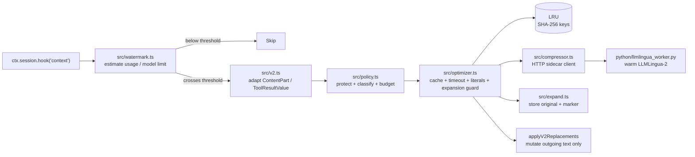

# System Architecture

This document describes the architectural design, lifecycle, and component interactions of `opencode-context-optimisations`.

> [!NOTE]
> **Status (2026-10-25):** implemented components are the classifier, selection policy, V2 transcript adapter, watermark gate, optimizer (LRU + timeout + literal validation + expansion guard), HTTP compressor client, context/compaction/tool hooks, reversible `context_expand` store/tool, optional warm Python worker, and the OpenCode Go quality harness. Caveats: the watermark uses a heuristic estimate rather than provider usage; the tool-output lane is default-off because replacement persistence is unverified; compaction is precompress-only; literal validation is a post-check rather than force-token protection.

---

## 1. System Context (C4 Level 1)

`opencode-context-optimisations` sits between the OpenCode agentic coding harness and frontier model providers (OpenAI, Anthropic, Google Gemini via OmniRoute or direct APIs).

```mermaid
flowchart TD
    User([Software Developer]) -->|Natural Language & Commands| OpenCode[OpenCode Agent Harness v2.1.3]
    
    subgraph Client System
        OpenCode -->|Execute Hooks| Plugin[Context Optimisations Plugin]
        Plugin -->|1. Adapt V2 messages| Adapter[V2 Transcript Adapter]
        Adapter -->|2. Classify & Select| Policy[Policy & Classifier Engine]
        Plugin -->|3. Compress cache misses| Worker[Warm HTTP LLMLingua-2 Sidecar (optional)]
    end
    
    subgraph Network Gateway
        Plugin -->|Optimized Messages| OmniRoute[OmniRoute Local Proxy :20128]
        OmniRoute -->|Post-plugin filters| RTK[RTK & Session-Dedup]
    end
    
    subgraph Hosted Frontier Providers
        OmniRoute -->|Bounded Context| Upstream[Anthropic / OpenAI / Google Gemini]
        Upstream -->|Completions| OpenCode
    end
```

---

## 2. Container & Component Architecture (C4 Level 2 & 3)

The internal system is composed of decoupled subsystems: the classifier, selection policy, V2 transcript adapter, watermark estimator, optimizer, literal validator, expand store, HTTP compressor client, tool-result extractor, and OpenCode plugin. The diagrams below show the classification/selection logic and the implemented request path.

```mermaid
graph TD
    subgraph "src/classify.ts"
        A[Input Text Part] --> B{Length / Empty?}
        B -->|Empty| C[Empty]
        B -->|>= 2 chars| D{Looks like JSON?}
        D -->|Valid JSON Object/Array| E[JSON - Protected]
        D -->|No| F[Line Pattern Analysis]
        F --> G[Regex: Code keywords, imports, exports]
        F --> H[Regex: Structured log timestamps, tracebacks]
        F --> I[Regex: Unified diff headers @@, +++, ---]
        F --> J[Density: File paths & extensions]
        G & H & I & J --> K[Kind & Confidence Scoring]
        K --> L[Classification Verdict]
    end

    subgraph "src/policy.ts"
        M[Conversation Messages] --> N[userTurnBoundary]
        N --> O[Protect Last N User Turns]
        M --> P[System Message Filter]
        P -->|Role: system| Q[Reject: system]
        O --> R{Message Index < Protected?}
        R -->|Recent| S[Reject: recent]
        R -->|Old| T{Content Compressible?}
        T -->|Code/Diff/JSON/Log| U[Reject: content]
        T -->|Prose| V{Tokens >= minTokens?}
        V -->|No| W[Reject: small]
        V -->|Yes| X[Compute SHA-256 Cache Key]
        X --> Y[Sort Oldest-First]
        Y --> Z[Enforce Token Budget]
        Z --> Candidates[Eligible Candidates]
    end
```



### 2.1 Implemented request path



The plugin registers:
- `context` with the watermark gate above.
- `compaction`, which reuses the same adapter/policy/optimizer path on the
  transcript handed to the summarizer, but never sets `event.result`.
- `tool.execute.after` only when `toolOutputEnabled` is true; it extracts one
  textual slot, runs the same policy/optimizer path through a synthetic tool
  message, and replaces only that slot.
- `context_expand` via `ctx.tool.transform` when `expandToolEnabled` is true.

It never edits the persisted transcript, `event.system`, `event.tools`,
tool-call IDs, reasoning parts, media, or compaction checkpoints. Each hook
invocation reconstructs the adapter view and reapplies replacements because V2
context edits are transient.

---

## 3. The 3 Operational Layers

Context optimization operates across three distinct architectural layers. Only **Layer 1** reduces billed input tokens on hosted frontier APIs:

```
┌────────────────────────────────────────────────────────────────────────┐
│ Layer 1: Pre-Request Client/Gateway Compression (API-Compatible)       │
│ • Deterministic CLI output filtering (RTK)                             │
│ • Content-addressed cross-turn line deduplication (Session-Dedup)      │
│ • Tabular JSON array compaction (Headroom / SmartCrusher)              │
│ • Reversible caching with retrieval markers (CCR)                      │
│ • Selective SLM token pruning on aged prose (LLMLingua Request Lane)   │
│ → DIRECTLY REDUCES BILLED INPUT TOKENS ON OPENAI / ANTHROPIC / GEMINI │
└────────────────────────────────────┬───────────────────────────────────┘
                                     │ (HTTP / JSON over wire)
┌────────────────────────────────────▼───────────────────────────────────┐
│ Layer 2: White-Box Latent Vector Compression (Weights Required)        │
│ • ICAE (In-Context Autoencoder), AutoCompressor, Gist Tokens           │
│ → Replaces tokens with continuous memory activations / soft prompts.   │
│ → CANNOT BE USED WITH HOSTED BLACK-BOX FRONTIER APIS.                  │
└────────────────────────────────────────────────────────────────────────┘
┌────────────────────────────────────────────────────────────────────────┐
│ Layer 3: Inference Engine KV-Cache Eviction (Server-Side Decode)       │
│ • StreamingLLM (attention sinks), H2O, SnapKV, PyramidKV               │
│ → Manages GPU memory inside vLLM / llama.cpp during generation.        │
│ → ZERO REDUCTION IN BILLED INPUT TOKENS FOR API CONSUMERS.             │
└────────────────────────────────────────────────────────────────────────┘
```

---

## 4. End-to-End Request Lifecycle

When the OpenCode agent executes an action step:

1. **Transcript Construction:** OpenCode reconstructs `messages[]` from session history.
2. **Watermark:** The plugin estimates system + tools + messages + tool-call inputs and compares that against `ctx.model.list()`'s input/context limit minus a response reserve. Below `watermarkRatio` (default 0.70) the request lane returns without touching the transcript.
3. **V2 Adaptation:** `toPolicyTranscript()` maps:
   - `text` parts directly,
   - `tool-result` `text` and `content` text entries as eligible spans,
   - `tool-result` `json` and `error` values as protected spans,
   - tool calls, reasoning, media, and compaction parts as untouched.
4. **Policy Selection:** `selectLlmlinguaCandidates()` protects the recent user-turn window, system/role exclusions, code/diffs/JSON/logs, small chunks, and the token budget. Candidates are ordered oldest-first and hashed with `policy_version + model_id + rate + text`.
5. **Literal Gate:** `findMissingLiterals()` rejects output that loses a path, URL, number, line reference, or error code from the original. The raw compressed result is not cached when this check fails.
6. **Cache and Sidecar:**
   - LRU hits apply immediately.
   - Misses go to the optional HTTP sidecar with a per-candidate deadline (default 1,200 ms).
   - Empty output, timeouts, HTTP errors, and expansions at or above `maxCompressedRatio` leave the original text untouched.
7. **Expandability:** When enabled, `createExpandAnnotator()` stores the original in a bounded in-memory store and appends `[ctx_expand:ctx_...]` to the compressed text.
8. **Transient Mutation:** `applyV2Replacements()` writes only to the approved text/tool-result spans. IDs, tool-call pairing, and all non-text parts are preserved. The persisted transcript remains byte-verbatim.
9. **Compaction Lane:** If OpenCode compacts, the plugin pre-compresses the transcript through the same path using `compactionBudgetTokens` / `compactionTimeoutMs`, then leaves `event.result` unset so OpenCode's summarizer still runs over the compressed history.
10. **Tool-Output Lane (optional, default off):** After a completed tool, the plugin extracts one textual slot, runs the same policy/optimizer path through a synthetic tool message, and replaces only that slot. Errors and protected tools are skipped.
11. **Gateway Processing (optional, external):** If OpenCode is routed through OmniRoute, its own `session-dedup`, `headroom`, and opt-in `rtk` stages may run after the plugin. Those engines are not part of this repository.
12. **Model Completion:** The provider receives a payload whose system prompt, tool schemas, recent window, and technical content are unchanged.

---

## 5. Invariant Safety Policies

To prevent subtle hallucinations and syntax corruption in coding agents:

| Invariant | Enforcement Mechanism | Status |
|---|---|---|
| **Code Syntax Integrity** | Regex keyword density, fence isolation, structural checks; non-prose is never a candidate | Implemented |
| **Error Trace Preservation** | Log/stack heuristics; tool-result `error` values are marked protected before classification | Implemented |
| **Tool-Result Integrity** | Adapter preserves IDs/names/tool-call pairing and writes only to `result.value` or a content entry's `text` | Implemented |
| **JSON/Structured Data** | Tool-result `json` values are protected; top-level JSON is classified as `json` and refused | Implemented |
| **Prefix-Cache Alignment** | Plugin never edits `event.system` or `event.tools`; cache keys are deterministic | Implemented |
| **Instruction Recency** | Last *N* user turns protected; default 2, minimum 1 (explicit advanced override) | Implemented |
| **Fail-Open Design** | Per-candidate 1,200 ms timeout; backend error/empty/timeout and expansion guard leave original text | Implemented |
| **Watermark Gate** | Estimated request pressure + model limit; below-threshold requests are untouched | Implemented (heuristic) |
| **Numeric & Line-Number Fidelity** | Post-compression check requires paths, URLs, numbers, line references, and error codes to survive verbatim; failed spans are rejected before caching | Implemented (post-check) |
| **Expandability** | Originals in a bounded LRU with deterministic handles and a `context_expand` tool | Implemented (in-memory) |
| **Compaction Quality** | Pre-compress only; chronology preserved; never set `event.result`; code/errors/JSON protected | Implemented (precompress) |
| **Tool-Output Persistence** | Replacement is shown by the V2 docs, but persistence is unverified; lane is default-off | Unverified |
| **Compaction Avoidance** | Auto-compaction is decided before the `context` hook; compression cannot prevent that step's decision | Known limitation |

---

## 6. Gateway Integration Architecture (OmniRoute 3.8.51)

OmniRoute integration is external to this repository. The plugin does not
require a gateway, and no gateway code is bundled here. When OpenCode is routed
through OmniRoute (`http://localhost:20128/v1`):

- **Default State:** OmniRoute operates in `stacked` safe mode (`session-dedup` + `lite` + `ccr` + `headroom`).
- **Lossy Policy Gate:** Lossy engines (`rtk`, `llmlingua`, `caveman`) require the `x-omniroute-compression: allow-lossy` header.
- **Lite Tool Truncation Safeguard:** OmniRoute's `lite` engine truncates tool results before the current turn if they exceed 2,000 characters. For coding workflows, set `lite.compressToolResults = false` to preserve historical file reads.
