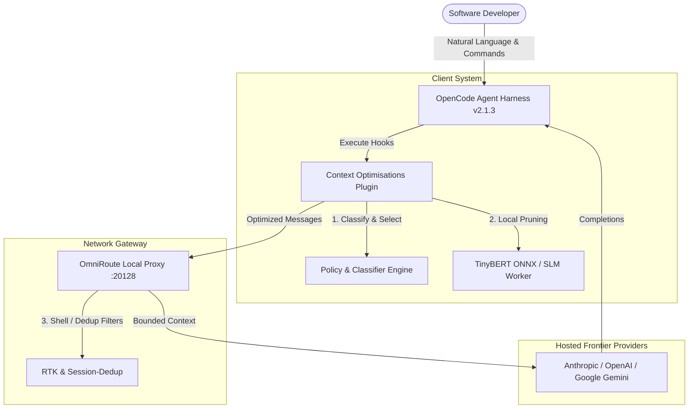

```mermaid
graph TD
    subgraph "src/classify.ts"
        A[Input Text Part] --> B{Length / Empty?}
        B -->|Empty| C[Empty]
        B -->|>= 2 chars| D{Looks like JSON?}
        D -->|Valid JSON Object/Array| E[JSON - Protected]
        D -->|No| F[Line Pattern Analysis]
        F --> G[Regex: Code keywords, imports, exports]
        F --> H[Regex: Structured log timestamps, tracebacks]
        F --> I[Regex: Unified diff headers @@, +++, ---]
        F --> J[Density: File paths & extensions]
        G & H & I & J --> K[Kind & Confidence Scoring]
        K --> L[Classification Verdict]
    end

    subgraph "src/policy.ts"
        M[Conversation Messages] --> N[userTurnBoundary]
        N --> O[Protect Last N User Turns]
        M --> P[System Message Filter]
        P -->|Role: system| Q[Reject: system]
        O --> R{Message Index < Protected?}
        R -->|Recent| S[Reject: recent]
        R -->|Old| T{Content Compressible?}
        T -->|Code/Diff/JSON/Log| U[Reject: content]
        T -->|Prose| V{Tokens >= minTokens?}
        V -->|No| W[Reject: small]
        V -->|Yes| X[Compute SHA-256 Cache Key]
        X --> Y[Sort Oldest-First]
        Y --> Z[Enforce Token Budget]
        Z --> Candidates[Eligible Candidates]
    end
```

# System Architecture

This document describes the architectural design, lifecycle, and component interactions of `opencode-context-optimisations`.

---

## 1. System Context (C4 Level 1)

`opencode-context-optimisations` sits between the OpenCode agentic coding harness and frontier model providers (OpenAI, Anthropic, Google Gemini via OmniRoute or direct APIs).



---

## 2. Container & Component Architecture (C4 Level 2 & 3)

The internal system is composed of four decoupled subsystems:



---

## 3. The 3 Operational Layers

Context optimization operates across three distinct architectural layers. Only **Layer 1** reduces billed input tokens on hosted frontier APIs:

```
┌────────────────────────────────────────────────────────────────────────┐
│ Layer 1: Pre-Request Client/Gateway Compression (API-Compatible)       │
│ • Deterministic CLI output filtering (RTK)                             │
│ • Content-addressed cross-turn line deduplication (Session-Dedup)      │
│ • Tabular JSON array compaction (Headroom / SmartCrusher)              │
│ • Reversible caching with retrieval markers (CCR)                      │
│ • Selective SLM token pruning on aged prose (LLMLingua Request Lane)   │
│ → DIRECTLY REDUCES BILLED INPUT TOKENS ON OPENAI / ANTHROPIC / GEMINI │
└────────────────────────────────────┬───────────────────────────────────┘
                                     │ (HTTP / JSON over wire)
┌────────────────────────────────────▼───────────────────────────────────┐
│ Layer 2: White-Box Latent Vector Compression (Weights Required)        │
│ • ICAE (In-Context Autoencoder), AutoCompressor, Gist Tokens           │
│ → Replaces tokens with continuous memory activations / soft prompts.   │
│ → CANNOT BE USED WITH HOSTED BLACK-BOX FRONTIER APIS.                  │
└────────────────────────────────────────────────────────────────────────┘
┌────────────────────────────────────────────────────────────────────────┐
│ Layer 3: Inference Engine KV-Cache Eviction (Server-Side Decode)       │
│ • StreamingLLM (attention sinks), H2O, SnapKV, PyramidKV               │
│ → Manages GPU memory inside vLLM / llama.cpp during generation.        │
│ → ZERO REDUCTION IN BILLED INPUT TOKENS FOR API CONSUMERS.             │
└────────────────────────────────────────────────────────────────────────┘
```

---

## 4. End-to-End Request Lifecycle

When the OpenCode agent executes an action step:

1. **Transcript Construction:** OpenCode reconstructs `messages[]` from session history.
2. **`context` Hook Invocations:**
   - The plugin intercepts `event.messages`.
   - `selectLlmlinguaCandidates(event.messages)` scans messages oldest-first.
   - The last *N* user turns (default 2), system prompts, code blocks, diffs, JSON, and logs are marked untouchable.
   - Eligible stale prose parts are hashed via SHA-256 (`policy_version + model_id + rate + text`).
3. **Cache Lookup:**
   - Hits return previously compressed text in `< 1 ms`.
   - Misses dispatch to a warm worker thread (TinyBERT ONNX / LLMLingua-2), compressing text at rate `0.6`.
4. **Transient Mutation:** `event.messages` is modified in-place for the outgoing HTTP payload only. The session's on-disk transcript remains byte-verbatim.
5. **Gateway Processing (OmniRoute):**
   - `session-dedup` replaces duplicate cross-turn line blocks with `[dedup:ref sha=...]`.
   - `headroom` compacts large uniform JSON arrays (>= 8 rows).
   - If opted-in via `x-omniroute-compression: allow-lossy`, `rtk` prunes verbose bash tool results while retaining error lines and summaries.
6. **Model Completion:** Provider receives an optimized payload with intact syntax, accurate line numbers, and stabilized prefix caching.

---

## 5. Invariant Safety Policies

To prevent subtle hallucinations and syntax corruption in coding agents:

| Invariant | Enforcement Mechanism | Failure Mode Prevented |
|---|---|---|
| **Code Syntax Integrity** | Regex keyword density + fence isolation | `tsc` compilation errors (`TS1005`), lost brackets/semicolons |
| **Error Trace Preservation** | Explicit log regex detecting stack traces | Lost error locations, missing stack frames |
| **Numeric & Line-Number Fidelity** | Numeric preservation check | Hallucinated line offsets in patches and diffs |
| **Prefix-Cache Alignment** | Zero modification to system prompt and tool definitions | Provider prompt cache invalidation (50–90% cost penalty) |
| **Instruction Recency** | Strict user turn protection window (`protectedTurns >= 2`) | Forgetting user constraints, corrections, and immediate task goals |
| **Fail-Open Design** | Timeouts (1,200 ms) and parse-error fallbacks return raw text | Blocked tool loops or aborted agent execution |

---

## 6. Gateway Integration Architecture (OmniRoute 3.8.51)

When using OmniRoute as a proxy gateway (`http://localhost:20128/v1`):

- **Default State:** OmniRoute operates in `stacked` safe mode (`session-dedup` + `lite` + `ccr` + `headroom`).
- **Lossy Policy Gate:** Lossy engines (`rtk`, `llmlingua`, `caveman`) require the `x-omniroute-compression: allow-lossy` header.
- **Lite Tool Truncation Safeguard:** OmniRoute's `lite` engine truncates tool results before the current turn if they exceed 2,000 characters. For coding workflows, set `lite.compressToolResults = false` to preserve historical file reads.
